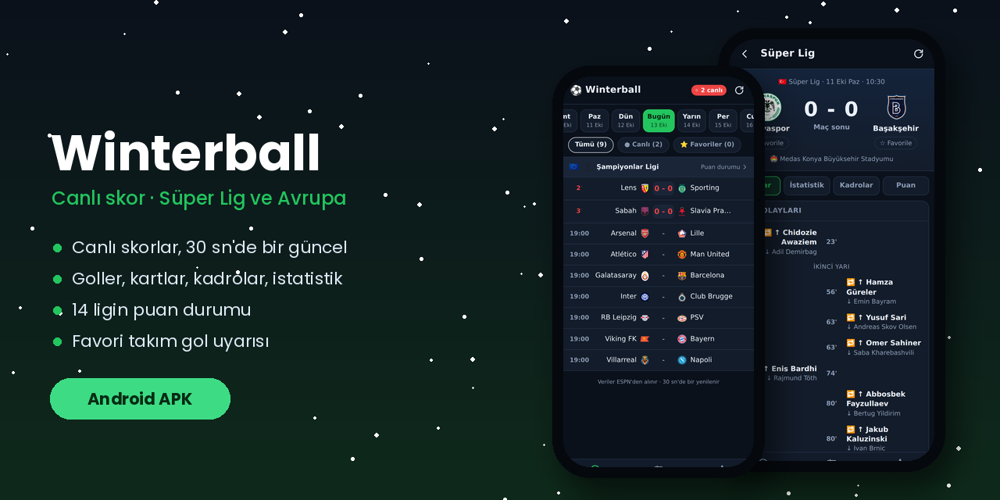

# ⚽ Winterball

**Canlı skorlar, maç olayları ve puan durumları, telefonuna özel.**

<!-- ENS:TANITIM -->
## 🎬 Tanıtım

Tam kalitede izlemek için görsele tıkla · MP4, 37 saniye

<!-- /ENS:TANITIM -->

## Neler var?

- **Maçlar:** Dünden haftaya kadar her günün maçları, liglere göre gruplu. Canlı maçlarda dakika ve skor 30 saniyede bir kendiliğinden yenilenir.
- **Canlı / Favoriler filtresi:** Sadece oynanan maçları ya da takımlarının maçlarını gör.
- **Maç detayı:** Goller, asistler, kartlar ve oyuncu değişiklikleri; topla oynama, şut, korner gibi istatistikler; ilk 11'ler ve yedekler.
- **Puan durumu:** Süper Lig, 1. Lig, Avrupa kupaları ve büyük Avrupa ligleri. Avrupa kupası ve küme düşme hatları renkli.
- **Takımlarım:** Favori takımlarının son ve sıradaki maçları. Uygulama açıkken favori takımın gol atarsa titreşim ve sesle uyarır.

**Ligler:** Süper Lig, 1. Lig, Şampiyonlar Ligi, Avrupa Ligi, Konferans Ligi, Uluslar Ligi, Dünya Kupası Elemeleri, Premier Lig, La Liga, Serie A, Bundesliga, Ligue 1, Eredivisie, Liga Portugal.

## Kurulum

Yukarıdaki **APK indir** butonuna dokun, dosyayı aç. Telefon ilk seferde "bilinmeyen kaynaklardan yükleme" izni isteyebilir.

## Nasıl çalışıyor?

Maç verileri ESPN'in herkese açık skor servisinden gelir; hesap ya da anahtar gerekmez. Uygulama düz HTML, CSS ve JavaScript ile yazıldı. Her yüklemede GitHub Actions:

- APK'yı derleyip **Releases** sayfasına koyar,
- web sürümünü GitHub Pages'te yayınlar,
- uygulamayı gerçek veriyle açıp ekran görüntülerini `test-sonuc` dalına kaydeder.

<!-- ENS:ALT -->
---

**❄️ ENS Developer'ın diğer projeleri**

📱 Telefon: [GolHaber](https://github.com/Enskygr234/golhaber) · [Yemek Tarifleri](https://github.com/Enskygr234/ensdewloper.github.io/tree/main/tarifler)

[🌐 Bütün projeler](https://enskygr234.github.io/ensdewloper.github.io/) · [👤 GitHub profilim](https://github.com/Enskygr234)

Kış gelir, kod yazılır.

<!-- /ENS:ALT -->
